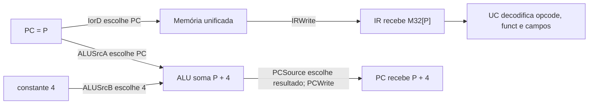
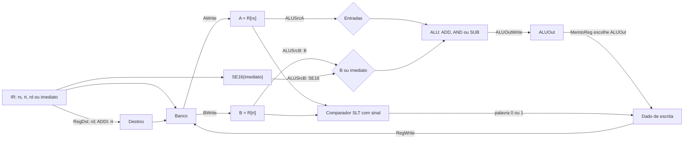
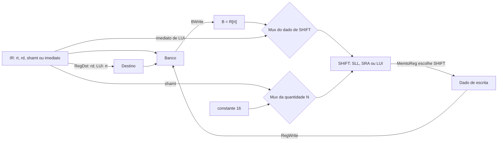
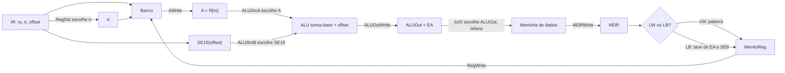
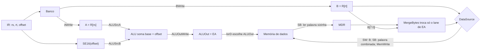
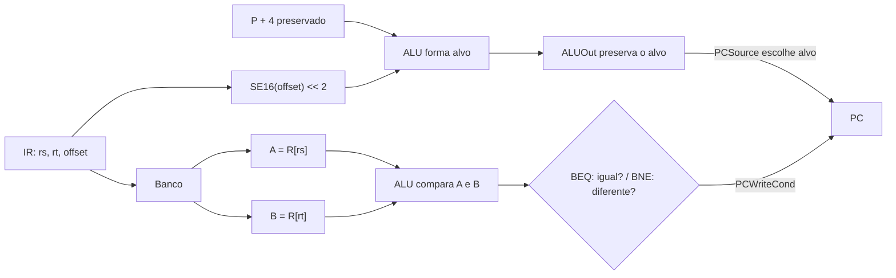
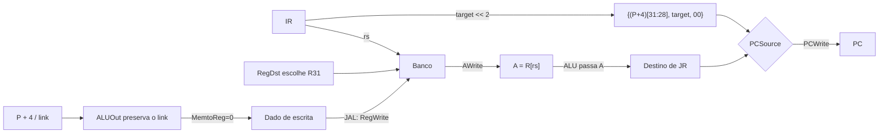
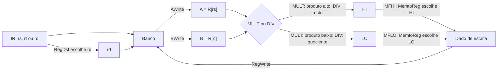
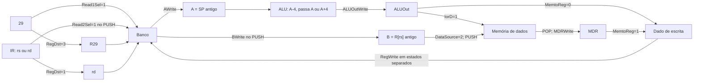

# 02 — Catálogo didático das 23 instruções

[Índice](README.md) · [Dicionário](10-dicionario-de-siglas-e-termos.md) · [Arquitetura e sinais](03-arquitetura-e-sinais.md) · [Roteiro de apresentação](05-roteiro-de-apresentacao.md) · [Estados de PUSH/POP](04-maquina-de-estados.md) · [Mermaid](08-atlas-mermaid.md)

> Este catálogo não serve apenas para consultar opcode e funct. Ele explica, para cada instrução, **o que ela precisa fazer, de onde os dados vêm, por quais blocos passam, onde o resultado fica e por que esse caminho existe**. A sequência descrita é lógica; a FSM que ativará os controles em cada ciclo é a próxima etapa do projeto.

## 1. Como usar este catálogo

Ao explicar uma instrução, siga sempre o mesmo raciocínio:

1. **Objetivo:** qual alteração ela precisa produzir em registradores, memória ou PC.
2. **Entradas:** quais campos saem do IR e quais valores são lidos do banco.
3. **Caminho:** quais muxes, unidades e registradores intermediários são usados.
4. **Resultado:** onde o valor final é escrito, ou qual parte do processador é alterada.
5. **Motivo do caminho:** qual hardware é reutilizado e por que um registrador intermediário é necessário.

Assim, uma frase como “LW passa pela memória” deixa de ser vaga. A explicação completa é: “LW calcula o endereço com a ALU, preserva-o em ALUOut, faz IorD selecionar esse endereço, armazena a palavra lida em MDR e escreve MDR em rt.”

## 2. Vocabulário comum e busca da instrução

| Termo | Significado no diagrama |
|---|---|
| **P** | Endereço da instrução antes da busca. Depois da busca, o fluxo sequencial deixa PC em P+4. |
| **A e B** | Registradores intermediários que preservam valores lidos do banco: em geral A recebe R[rs] e B recebe R[rt]. |
| **ALUOut** | Registrador que preserva um resultado da ALU, como um endereço efetivo ou resultado aritmético, para uso posterior. |
| **MDR** | Registrador que preserva o dado lido da memória antes de ele seguir ao banco ou ao tratamento de byte. |
| **EA** | Endereço efetivo de um acesso à memória, normalmente A + imediato estendido. |
| **M32[a] e M8[a]** | Palavra de 32 bits, ou byte, iniciando no endereço a. A memória do projeto é endereçada por byte. |
| **SE16 e SE8** | Extensão com sinal de 16 ou 8 bits para 32 bits. |
| **SP** | Stack Pointer, o ponteiro da pilha. Neste projeto ele é R29. |

### Busca comum: todas as 23 instruções começam aqui

Suponha que PC = 100 e que a próxima instrução esteja em M[100].

1. **IorD** seleciona PC como endereço da memória, pois a memória está sendo usada para buscar uma instrução.
2. A palavra M[100] entra em **IR** quando **IRWrite** é habilitado.
3. Em paralelo, a ALU calcula 100 + 4.
4. **PCSource** seleciona esse resultado e **PCWrite** atualiza PC para 104.
5. A partir de IR, a UC passa a conhecer opcode, rs, rt, rd, imediato, shamt ou target e pode configurar o caminho específico da instrução.

Não é necessário repetir esta busca em cada item abaixo: todos os caminhos descritos começam **depois** dela.

> **Busca não é acesso a dado.** Na busca, `IorD` escolhe **PC**, a palavra retornada entra em **IR** e o PC avança. Em LW, LB, SW, SB, PUSH ou POP, `IorD` escolhe **ALUOut**, que contém um endereço efetivo; uma leitura de dados entra em **MDR**, enquanto uma escrita recebe seu dado por **DataSource**. A memória física é a mesma, mas a finalidade, o endereço selecionado e o registrador de destino são diferentes.
>
> Como a memória do projeto tem leitura síncrona, a UC deve requisitar, manter o endereço e só habilitar `IRWrite` ou `MDRWrite` quando a saída estiver válida. Os diagramas mostram o percurso dos dados; eles não eliminam os ciclos de espera exigidos pela implementação.

### Como ler os diagramas e os roteiros individuais

Os diagramas das famílias mostram o **caminho dominante dos dados**, não estados simultâneos. Cada seta pode corresponder a um ciclo diferente. `AWrite`, `BWrite`, `ALUOutWrite`, `MDRWrite`, `IRWrite`, `RegWrite` e `PCWrite` indicam quando um registrador captura; quando o enable fica em zero, ele conserva o valor para o ciclo seguinte.

Os valores numéricos de seletor só aparecem quando estão confirmados no desenho: na extensão de pilha, por exemplo, `RegDst=3` escolhe R29, `MemtoReg=0` escolhe ALUOut, `MemtoReg=1` escolhe MDR e `DataSource=2` escolhe B. Para entradas antigas ainda pendentes de conferência, o texto nomeia a **fonte selecionada** sem inventar um código.

| Seletor | Escolhas confirmadas usadas neste catálogo |
|---|---|
| `Read1Sel` | 0 = `rs`; 1 = R29. |
| `Read2Sel` | 0 = `rt`; 1 = `rs`. |
| `ALUSrcA` | 0 = PC; 1 = A. |
| `ALUSrcB` | 0 = B; 1 = constante 4; 2 = `SE16`; 3 = `SE16 << 2`. |
| `IorD` | 0 = PC, para busca; 1 = ALUOut, para acesso a dados. |
| `RegDst` | 0 = `rt`; 1 = `rd`; 2 = R31; 3 = R29. |
| `MemtoReg` | 0 = ALUOut; 1 = MDR; 2 = HI; 3 = LO; 4 = SHIFT; 5 = resultado LT. As entradas antigas 6/7 ficam com a função documentada no circuito; 8 = constante 227. |
| `DataSource` | 1 = MergeBytes, usado por SB; 2 = B, usado por SW/PUSH. |

Na captura normal, `Read1Sel=0` e `Read2Sel=0`, portanto A recebe `R[rs]` e B recebe `R[rt]`. PUSH e POP são as exceções que mandam a porta 1 ler R29; PUSH também manda a porta 2 ler `rs`.

## 3. Formatos e cobertura do conjunto

| Formato | Campos, do bit mais alto ao mais baixo |
|---|---|
| R | opcode[31:26], rs[25:21], rt[20:16], rd[15:11], shamt[10:6], funct[5:0] |
| I | opcode[31:26], rs[25:21], rt[20:16], imediato[15:0] |
| J | opcode[31:26], target[25:0] |

O conjunto exigido tem **13 instruções R, 8 I e 2 J**. PUSH e POP substituem XCHG e SRAM; elas são as únicas extensões de instrução desta revisão.

## 4. Agrupamento por reaproveitamento do datapath

Este agrupamento serve para a apresentação. Ele não substitui os formatos R, I e J nem a decodificação por opcode/funct; ele mostra quais instruções percorrem praticamente o mesmo circuito.

Quando dizemos que duas instruções compartilham “mais de 70%” do fluxo, isso significa que elas compartilham o **caminho dominante de dados** — registradores de entrada, muxes principais, unidade de cálculo, registradores intermediários e destino. Não é uma contagem literal de fios. A melhor forma de apresentar um grupo é explicar uma instrução representativa por completo e, em seguida, mostrar apenas o que muda nas demais.

Cada instrução aparece em um grupo principal abaixo. Algumas pertencem também a uma família mais ampla de reuso; por exemplo, LW e SW compartilham o cálculo do endereço, embora uma leia e a outra escreva.

### 4.1 Mapa dos grupos

| Grupo | Instruções | Caminho predominante compartilhado | Melhor instrução para explicar primeiro |
|---|---|---|---|
| **G0 — Busca comum** | Todas as 23 | PC → IorD → memória → IR, enquanto a ALU produz P+4. | Qualquer instrução; explique a busca uma única vez. |
| **G1 — Resultado de ALU no banco** | [ADD](#i01-add), [AND](#i02-and), [SUB](#i11-sub), [SLT](#i09-slt), [ADDI](#i14-addi) | Banco → A/B ou imediato → ALU/comparador → resultado → banco. | ADD. |
| **G2 — Deslocamento e formação de constante** | [SLL](#i08-sll), [SRA](#i10-sra), [LUI](#i18-lui) | Fonte → SHIFT → MemtoReg → registrador destino. | SLL. |
| **G3 — Carga da memória** | [LW](#i19-lw), [LB](#i17-lb) | Base + offset → ALUOut → IorD → memória → MDR → banco. | LW. |
| **G4 — Armazenamento na memória** | [SW](#i21-sw), [SB](#i20-sb) | Base + offset → ALUOut → IorD → memória; B fornece o dado a gravar. | SW. |
| **G5 — Desvio condicional** | [BEQ](#i15-beq), [BNE](#i16-bne) | Formação do alvo + comparação A/B + PCWriteCond + PCSource. | BEQ. |
| **G6 — Alteração incondicional do PC** | [J](#i22-j), [JAL](#i23-jal), [JR](#i05-jr) | Formação/seleção de destino → PCSource → PC. | J. |
| **G7 — Família HI/LO** | [MULT](#i04-mult), [DIV](#i03-div), [MFHI](#i06-mfhi), [MFLO](#i07-mflo) | A/B → unidade especial → HI/LO, ou HI/LO → MemtoReg → rd. | MULT seguido de MFLO. |
| **G8 — Pilha** | [PUSH](#i12-push), [POP](#i13-pop) | R29 → A → ALU/ALUOut → IorD → memória, com escrita no banco. | PUSH seguido de POP. |

Os grupos G1 a G8 somam as 23 instruções. G0 é transversal: a busca comum acontece antes do caminho específico de qualquer grupo.

### 4.2 G1 — Resultado de ALU no banco: ADD, AND, SUB, SLT e ADDI

Estas cinco instruções terminam escrevendo um resultado no banco de registradores. O núcleo compartilhado é: ler operandos, preservar o valor em A e/ou B, produzir um resultado de cálculo e usar o caminho normal de escrita no banco.

- **ADD, AND e SUB** são o núcleo mais parecido do grupo. Todos usam A e B, passam pela ALU, guardam o resultado em ALUOut e escrevem em rd. Muda somente a função escolhida para a ALU.
- **SLT** preserva a mesma leitura de A e B e a mesma escrita em rd, mas o resultado da comparação precisa virar uma palavra 0 ou 1 antes do write-back.
- **ADDI** preserva o caminho A → ALU → ALUOut → banco, mas troca B pelo imediato estendido e troca o destino de rd para rt.

Fala recomendada: “Explico ADD completamente. AND e SUB mudam apenas a operação da ALU; SLT muda a forma do resultado para 0 ou 1; ADDI troca o segundo registrador pelo imediato e escreve em rt.”

### 4.3 G2 — Deslocamento e formação de constante: SLL, SRA e LUI

As três instruções usam o bloco **SHIFT** como unidade principal e, depois dele, compartilham o retorno do resultado ao banco por MemtoReg e RegDst.

- **SLL** e **SRA** são quase idênticas: B fornece o valor, shamt fornece a quantidade e SHIFT gera o resultado. A diferença é o modo de deslocamento: SLL insere zeros; SRA preserva o sinal.
- **LUI** usa a mesma saída de SHIFT e o mesmo write-back, mas a fonte vem do imediato e a quantidade é fixa em 16. Seu objetivo é formar a metade alta de uma constante, não deslocar o conteúdo de rt.

Fala recomendada: “SLL é o caso-base. SRA usa a mesma unidade, porém propaga o bit de sinal. LUI reutiliza o deslocador para posicionar o imediato nos 16 bits altos.”

### 4.4 G3 — Carga da memória: LW e LB

LW e LB compartilham quase todo o caminho: rs vai para A, o offset é estendido, a ALU calcula EA, ALUOut preserva esse endereço, IorD o envia à memória e MDR retém o que foi lido. Em seguida, ambas escrevem em rt.

- **LW** envia a palavra de MDR diretamente para o banco.
- **LB** seleciona um único byte de MDR e faz extensão com sinal antes da escrita.

Fala recomendada: “LW explica o caminho comum completo. LB segue o mesmo caminho até MDR; só acrescenta a escolha do byte e a extensão de sinal.”

### 4.5 G4 — Armazenamento na memória: SW e SB

SW e SB compartilham a mesma preparação de endereço: rs fica em A, rt fica em B, a ALU calcula EA e ALUOut preserva o endereço que IorD envia à memória. As duas terminam com MemWrite, e não com RegWrite.

- **SW** manda a palavra de B diretamente para a memória.
- **SB** precisa preservar os três bytes vizinhos da palavra. Por isso, lê a palavra afetada, usa MergeBytes para trocar somente o lane desejado e só então escreve a palavra combinada.

Fala recomendada: “SW é o armazenamento direto. SB é o mesmo caminho de endereço, mas precisa de uma etapa adicional de combinação para não destruir bytes vizinhos.”

### 4.6 G5 — Desvio condicional: BEQ e BNE

BEQ e BNE calculam o mesmo alvo e comparam os mesmos operandos. Ambos usam o imediato estendido e deslocado, combinam-no com P+4, comparam A e B e usam PCWriteCond com PCSource.

- **BEQ** atualiza PC quando a comparação indica igualdade.
- **BNE** reaproveita tudo, mas atualiza PC quando a comparação indica diferença.

Fala recomendada: “O hardware do alvo e do comparador é exatamente o mesmo. A única mudança é a interpretação da condição que libera a escrita do PC.”

### 4.7 G6 — Alteração incondicional do PC: J, JAL e JR

As três instruções terminam no mesmo lugar: **PCSource seleciona um destino e PCWrite atualiza PC**. O que muda é a origem do destino e se existe uma escrita adicional no banco.

- **J** monta o destino a partir de P+4 e do campo target do IR.
- **JAL** usa o mesmo destino de J e ainda grava P+4 em R31 para permitir retorno.
- **JR** não monta target a partir do IR: ele passa o conteúdo de rs, preservado em A, pelo caminho da ALU até PCSource.

J e JAL são o par com maior reaproveitamento do grupo. JR compartilha a etapa final PCSource → PC, mas se diferencia porque o endereço vem de um registrador.

Fala recomendada: “J é o caso-base. JAL acrescenta a gravação do endereço de retorno em R31. JR troca a fonte do destino: em vez de target, usa rs.”

### 4.8 G7 — Família HI/LO: MULT, DIV, MFHI e MFLO

Este grupo compartilha os registradores especiais **HI** e **LO**, mas possui dois subcaminhos complementares.

- **MULT** e **DIV** leem A e B, iniciam uma unidade especial e aguardam seu resultado. Ambos escrevem HI e LO; o que muda é a operação e o significado dos resultados: produto alto/baixo em MULT, resto/quociente em DIV.
- **MFHI** e **MFLO** fazem o caminho de retorno. Ambos selecionam um registrador especial por MemtoReg e escrevem em rd; muda somente a fonte escolhida, HI ou LO.

Fala recomendada: “MULT e DIV produzem valores em HI/LO; MFHI e MFLO apenas transferem esses valores para o banco. Explicar MULT seguido de MFLO mostra os dois lados da família.”

### 4.9 G8 — Pilha: PUSH e POP

PUSH e POP compartilham a seleção de **R29 como SP**, o registro A, a ALU, ALUOut, IorD, a memória e a porta normal de escrita do banco. Por isso podem ser apresentados como uma família de pilha. Porém, eles têm ordens de efeito diferentes e não devem ser tratados como a mesma sequência.

- **PUSH** calcula SP − 4, atualiza R29 e grava B na memória no novo endereço.
- **POP** usa o SP atual como endereço, lê a memória para MDR, grava rd e só depois calcula SP + 4.

Fala recomendada: “Os dois reutilizam o mesmo hardware de pilha. PUSH desloca o topo para baixo e grava; POP lê o topo atual e só depois o desloca para cima. A diferença de ordem preserva o valor correto.”

### 4.10 Ordem mais eficiente para explicar os grupos

1. Explique **G0** uma vez: busca e PC+4.
2. Explique **G1** com ADD e cite as variações.
3. Explique **G2** com SLL e cite SRA/LUI.
4. Explique **G3** com LW e **G4** com SW; depois mostre LB/SB como variações de byte.
5. Explique **G5** com BEQ e **G6** com J; cite as diferenças de BNE, JAL e JR.
6. Explique **G7** com MULT seguido de MFLO.
7. Feche com **G8**, usando o exemplo numérico 227 → 223 → 227 de PUSH/POP.

Essa ordem evita repetir o mesmo caminho várias vezes e evidencia o princípio de reuso de hardware pedido pela primeira entrega.

## 5. Índice rápido

| ID | Instrução | Formato | Opcode | Funct |
|---|---|---:|---:|---:|
| I01 | [ADD](#i01-add) | R | 0x00 | 0x20 |
| I02 | [AND](#i02-and) | R | 0x00 | 0x24 |
| I03 | [DIV](#i03-div) | R | 0x00 | 0x1A |
| I04 | [MULT](#i04-mult) | R | 0x00 | 0x18 |
| I05 | [JR](#i05-jr) | R | 0x00 | 0x08 |
| I06 | [MFHI](#i06-mfhi) | R | 0x00 | 0x10 |
| I07 | [MFLO](#i07-mflo) | R | 0x00 | 0x12 |
| I08 | [SLL](#i08-sll) | R | 0x00 | 0x00 |
| I09 | [SLT](#i09-slt) | R | 0x00 | 0x2A |
| I10 | [SRA](#i10-sra) | R | 0x00 | 0x03 |
| I11 | [SUB](#i11-sub) | R | 0x00 | 0x22 |
| I12 | [PUSH](#i12-push) | R | 0x00 | 0x05 |
| I13 | [POP](#i13-pop) | R | 0x00 | 0x06 |
| I14 | [ADDI](#i14-addi) | I | 0x08 | — |
| I15 | [BEQ](#i15-beq) | I | 0x04 | — |
| I16 | [BNE](#i16-bne) | I | 0x05 | — |
| I17 | [LB](#i17-lb) | I | 0x20 | — |
| I18 | [LUI](#i18-lui) | I | 0x0F | — |
| I19 | [LW](#i19-lw) | I | 0x23 | — |
| I20 | [SB](#i20-sb) | I | 0x28 | — |
| I21 | [SW](#i21-sw) | I | 0x2B | — |
| I22 | [J](#i22-j) | J | 0x02 | — |
| I23 | [JAL](#i23-jal) | J | 0x03 | — |

## 6. Instruções do tipo R

### I01 — ADD

**Sintaxe e codificação:** <code>add rd, rs, rt</code> · opcode 0x00 · funct 0x20.

**O que deve acontecer:** somar dois valores com sinal e escrever o resultado em rd: <code>R[rd] ← R[rs] + R[rt]</code>.

**Caminho, passo a passo:**

1. O banco lê rs e rt; seus valores são preservados em A e B.
2. `ALUSrcA=1` seleciona A, `ALUSrcB=0` seleciona B e a ALU recebe o comando de soma.
3. O resultado é preservado em ALUOut.
4. `RegDst=1` seleciona rd, `MemtoReg=0` seleciona ALUOut e RegWrite grava o resultado no banco.
5. Se houver overflow, a escrita normal em rd deve ser bloqueada e o caminho de exceção deve ser usado.

**Por que esse caminho existe:** a mesma ALU que também calcula endereços e PC+4 executa a soma; ALUOut mantém o valor estável até a escrita.

**Exemplo de verificação:** R8 = 7 e R9 = −2 devem produzir R10 = 5 em <code>add R10, R8, R9</code>. Testar também 0x7FFFFFFF + 1 como overflow.

### I02 — AND

**Sintaxe e codificação:** <code>and rd, rs, rt</code> · opcode 0x00 · funct 0x24.

**O que deve acontecer:** aplicar AND bit a bit: <code>R[rd] ← R[rs] AND R[rt]</code>.

**Caminho, passo a passo:**

1. rs e rt são lidos e preservados em A e B.
2. `ALUSrcA=1` e `ALUSrcB=0` selecionam A e B; o controle da ALU escolhe AND.
3. ALUOut guarda o resultado.
4. `RegDst=1` escolhe rd e `MemtoReg=0` escolhe ALUOut antes de RegWrite gravar o banco.

**Por que esse caminho existe:** ADD, AND, SUB e SLT compartilham o mesmo percurso geral; somente a função da ALU muda.

**Exemplo de verificação:** <code>0xF0F000FF AND 0x0FF00F0F = 0x00F0000F</code>.

### I03 — DIV

**Sintaxe e codificação:** <code>div rs, rt</code> · opcode 0x00 · funct 0x1A.

**O que deve acontecer:** dividir valores com sinal; o quociente vai para LO e o resto vai para HI.

**Caminho, passo a passo:**

1. O banco lê rs e rt, preservando os dividendos em A e B.
2. A UC inicia o divisor com A e B e aguarda sua conclusão; DIV não escreve diretamente no banco geral.
3. Quando a operação termina, o quociente é registrado em LO e o resto em HI.
4. Uma instrução posterior MFLO ou MFHI transfere o resultado escolhido para rd.

**Por que esse caminho existe:** HI e LO evitam criar uma porta especial de escrita no banco para um resultado que pode precisar de duas palavras conceituais, quociente e resto.

**Exemplo de verificação:** em <code>div R8, R9</code>, com R8 = −7 e R9 = 3, LO deve receber −2 e HI deve receber −1. Divisor zero deve seguir o tratamento definido para a exceção de divisão.

### I04 — MULT

**Sintaxe e codificação:** <code>mult rs, rt</code> · opcode 0x00 · funct 0x18.

**O que deve acontecer:** multiplicar valores com sinal e guardar o produto de 64 bits em HI:LO.

**Caminho, passo a passo:**

1. rs e rt são lidos do banco e preservados em A e B.
2. A UC inicia o multiplicador usando A e B e aguarda o sinal de conclusão.
3. A metade alta do produto é escrita em HI e a metade baixa em LO.
4. MFHI e MFLO poderão escolher uma dessas metades e escrevê-la em rd.

**Por que esse caminho existe:** o multiplicador pode demandar mais ciclos que a ALU comum; HI e LO retêm o produto até uma instrução de transferência solicitá-lo.

**Exemplo de verificação:** −3 × 7 produz HI = 0xFFFFFFFF e LO = 0xFFFFFFEB.

### I05 — JR

**Sintaxe e codificação:** <code>jr rs</code> · opcode 0x00 · funct 0x08.

**O que deve acontecer:** usar o conteúdo de rs como próximo PC: <code>PC ← R[rs]</code>.

**Caminho, passo a passo:**

1. O banco lê rs e preserva seu conteúdo em A.
2. `ALUSrcA=1` seleciona A e a ALU é configurada para **passar A**, sem alterá-lo.
3. PCSource seleciona esse caminho e PCWrite atualiza o PC com o valor de rs.
4. Não há escrita no banco nem acesso de dados à memória.

**Por que esse caminho existe:** a arquitetura reaproveita o caminho ALU → PCSource, em vez de criar uma ligação exclusiva de A para PC.

**Exemplo de verificação:** se R8 = 0x80, <code>jr R8</code> deve fazer o próximo PC ser 0x80.

### I06 — MFHI

**Sintaxe e codificação:** <code>mfhi rd</code> · opcode 0x00 · funct 0x10.

**O que deve acontecer:** transferir HI para um registrador geral: <code>R[rd] ← HI</code>.

**Caminho, passo a passo:**

1. HI já contém um resultado previamente produzido por MULT ou DIV.
2. `MemtoReg=2` seleciona HI como fonte de dado de escrita.
3. `RegDst=1` seleciona rd e RegWrite grava HI no banco.
4. HI não é modificado pela instrução; apenas é lido.

**Por que esse caminho existe:** o caminho de retorno ao banco é compartilhado com resultados da ALU, MDR, LO e SHIFT. MemtoReg escolhe qual deles será escrito.

**Exemplo de verificação:** com HI = 0x12345678, <code>mfhi R10</code> deve colocar 0x12345678 em R10 e preservar HI.

### I07 — MFLO

**Sintaxe e codificação:** <code>mflo rd</code> · opcode 0x00 · funct 0x12.

**O que deve acontecer:** transferir LO para um registrador geral: <code>R[rd] ← LO</code>.

**Caminho, passo a passo:**

1. LO já contém um resultado previamente produzido por MULT ou DIV.
2. `MemtoReg=3` seleciona LO.
3. `RegDst=1` seleciona rd e RegWrite grava LO no banco.
4. LO continua preservado após a leitura.

**Por que esse caminho existe:** MFLO reutiliza exatamente a porta normal de escrita do banco; ele só muda a fonte escolhida por MemtoReg.

**Exemplo de verificação:** com LO = 0x89ABCDEF, <code>mflo R10</code> deve gravar esse valor em R10.

### I08 — SLL

**Sintaxe e codificação:** <code>sll rd, rt, shamt</code> · opcode 0x00 · funct 0x00.

**O que deve acontecer:** deslocar R[rt] à esquerda por shamt posições: <code>R[rd] ← R[rt] &lt;&lt; shamt</code>.

**Caminho, passo a passo:**

1. O banco lê rt e preserva seu valor em B.
2. O campo shamt do IR fornece a quantidade de deslocamento.
3. Os muxes de SHIFT selecionam B e shamt; o bloco SHIFT executa o deslocamento lógico à esquerda.
4. `MemtoReg=4` seleciona a saída de SHIFT, `RegDst=1` escolhe rd e RegWrite grava o resultado.

**Por que esse caminho existe:** um bloco SHIFT dedicado atende deslocamentos sem sobrecarregar a ALU e também pode ser reaproveitado por LUI.

**Exemplo de verificação:** <code>3 &lt;&lt; 4 = 48</code>. Testar também shamt = 0 e shamt = 31.

### I09 — SLT

**Sintaxe e codificação:** <code>slt rd, rs, rt</code> · opcode 0x00 · funct 0x2A.

**O que deve acontecer:** escrever 1 quando R[rs] for menor que R[rt] em comparação com sinal; caso contrário, escrever 0.

**Caminho, passo a passo:**

1. rs e rt são lidos e preservados em A e B.
2. A unidade de comparação recebe A e B e produz o sinal LT.
3. Esse único bit é transformado em uma palavra de 32 bits: 31 zeros e LT no bit menos significativo.
4. `MemtoReg=5` seleciona o resultado de comparação, `RegDst=1` escolhe rd e RegWrite grava o banco.

**Por que esse caminho existe:** LT é só um bit de decisão; ele precisa ser estendido com zeros. Replicar LT pelos 32 bits daria um resultado incorreto.

**Exemplo de verificação:** −1 menor que 0 deve produzir 0x00000001. Valores iguais devem produzir 0.

### I10 — SRA

**Sintaxe e codificação:** <code>sra rd, rt, shamt</code> · opcode 0x00 · funct 0x03.

**O que deve acontecer:** deslocar R[rt] à direita mantendo o sinal: <code>R[rd] ← signed(R[rt]) &gt;&gt;&gt; shamt</code>.

**Caminho, passo a passo:**

1. rt é lido e preservado em B; shamt vem do IR.
2. SHIFT recebe B, shamt e o comando de deslocamento aritmético à direita.
3. SHIFT replica o bit de sinal nos bits que entram à esquerda.
4. `MemtoReg=4` seleciona SHIFT, `RegDst=1` escolhe rd e RegWrite grava o resultado.

**Por que esse caminho existe:** SRA compartilha o hardware de SLL, mas exige uma operação diferente porque zeros não podem substituir o bit de sinal.

**Exemplo de verificação:** <code>0x80000000 &gt;&gt;&gt; 4 = 0xF8000000</code>.

### I11 — SUB

**Sintaxe e codificação:** <code>sub rd, rs, rt</code> · opcode 0x00 · funct 0x22.

**O que deve acontecer:** subtrair valores com sinal: <code>R[rd] ← R[rs] − R[rt]</code>.

**Caminho, passo a passo:**

1. rs e rt são lidos e preservados em A e B.
2. `ALUSrcA=1` e `ALUSrcB=0` levam A e B à ALU, e o controle seleciona subtração.
3. ALUOut preserva o resultado.
4. `RegDst=1` escolhe rd; `MemtoReg=0` escolhe ALUOut; RegWrite só pode ocorrer se não houver overflow.

**Por que esse caminho existe:** SUB usa o mesmo datapath de ADD. O único elemento que muda é a função selecionada para a ALU.

**Exemplo de verificação:** 7 − (−2) deve produzir 9. O caso 0x80000000 − 1 deve sinalizar overflow.

### I12 — PUSH

**Sintaxe e codificação:** <code>push rs</code> · opcode 0x00 · funct 0x05.

**O que deve acontecer:** diminuir SP em quatro e armazenar o valor original de rs no novo topo: <code>SP ← SP antigo − 4; M32[SP] ← R[rs] antigo</code>.

**Caminho, passo a passo:**

1. Read1Sel seleciona R29, o SP; o valor antigo fica em A. Read2Sel seleciona rs; o dado a empilhar fica em B.
2. `ALUSrcA=1`, `ALUSrcB=1` e `F=010` fazem a ALU calcular A − 4; ALUOut preserva o novo endereço da pilha.
3. `RegDst=3` seleciona R29 e `MemtoReg=0` seleciona ALUOut; RegWrite atualiza SP.
4. `IorD=1` seleciona ALUOut como endereço da memória.
5. `DataSource=2` seleciona B e MemWrite grava o valor original de rs em M32[ALUOut].

**Por que esse caminho existe:** PUSH não cria um registrador de pilha novo. Ele usa R29, a ALU, ALUOut e a memória que já existem. B preserva rs inclusive em <code>push R29</code>, evitando gravar o SP já decrementado.

**Exemplo de verificação:** com SP = 227 e R8 = 0xAABBCCDD, <code>push R8</code> deixa SP = 223 e grava DD, CC, BB e AA nos endereços 223 a 226.

### I13 — POP

**Sintaxe e codificação:** <code>pop rd</code> · opcode 0x00 · funct 0x06.

**O que deve acontecer:** ler o topo atual da pilha para rd e aumentar SP em quatro: <code>R[rd] ← M32[SP antigo]; SP ← SP antigo + 4</code>.

**Caminho, passo a passo:**

1. Read1Sel seleciona R29. O valor atual de SP é preservado em A.
2. `ALUSrcA=1` e `F=000` configuram a ALU para **passar A**. Portanto, ALUOut recebe o endereço atual do SP sem alterá-lo: <code>ALUOut ← A</code>.
3. `IorD=1` seleciona ALUOut; a memória lê a palavra do topo e MDR preserva o valor retornado.
4. `RegDst=1` seleciona rd, `MemtoReg=1` seleciona MDR e RegWrite grava o dado recuperado no destino.
5. Depois da leitura, `ALUSrcA=1`, `ALUSrcB=1` e `F=001` fazem a ALU calcular A + 4. `RegDst=3` seleciona R29 e `MemtoReg=0` seleciona ALUOut para atualizar SP.

**Por que esse caminho existe:** a memória já recebe ALUOut como endereço de dado através de IorD. Passar A para ALUOut reutiliza essa ligação, em vez de criar uma conexão direta R29 → memória. SP só pode ser incrementado depois da leitura, pois antecipar o incremento faria POP procurar o endereço errado.

**Exemplo de verificação:** com SP = 223 e M32[223] = 0xAABBCCDD, <code>pop R9</code> deixa R9 = 0xAABBCCDD e SP = 227. As escritas em rd e R29 acontecem em momentos distintos, pois o banco tem uma única porta de escrita.

## 7. Instruções do tipo I

### I14 — ADDI

**Sintaxe e codificação:** <code>addi rt, rs, imm</code> · opcode 0x08.

**O que deve acontecer:** somar rs a um imediato com sinal: <code>R[rt] ← R[rs] + SE16(imm)</code>.

**Caminho, passo a passo:**

1. rs é lido e preservado em A; o imediato de 16 bits sai do IR.
2. O extensor de sinal transforma imm em uma palavra de 32 bits.
3. `ALUSrcA=1` seleciona A e `ALUSrcB=2` seleciona o imediato estendido. A ALU calcula a soma e ALUOut preserva o resultado.
4. `RegDst=0` seleciona rt e `MemtoReg=0` seleciona ALUOut; RegWrite grava o banco se não houver overflow.

**Por que esse caminho existe:** ADDI usa a ALU de ADD, mas o segundo operando não vem de B; vem do IR, por isso existe extensão de sinal e seleção de imediato.

**Exemplo de verificação:** se R8 = 5 e imm = −1, <code>addi R9, R8, −1</code> deve produzir R9 = 4.

### I15 — BEQ

**Sintaxe e codificação:** <code>beq rs, rt, offset</code> · opcode 0x04.

**O que deve acontecer:** se os operandos forem iguais, PC recebe <code>P + 4 + (SE16(offset) &lt;&lt; 2)</code>; caso contrário, PC permanece em P+4.

**Caminho, passo a passo:**

1. rs e rt são lidos e preservados em A e B.
2. Com PC já valendo P+4, `ALUSrcA=0` e `ALUSrcB=3` somam esse PC ao offset estendido e deslocado; ALUOut preserva o alvo para o ciclo da comparação.
3. `ALUSrcA=1` e `ALUSrcB=0` levam A e B à ALU, normalmente em subtração; o resultado indica igualdade.
4. PCWriteCond só permite a escrita do PC quando os valores são iguais. PCSource seleciona o alvo nesse caso.
5. Se os valores forem diferentes, nenhum novo destino é selecionado e PC continua em P+4.

**Por que esse caminho existe:** o alvo e a comparação usam recursos já existentes. O endereço do alvo precisa ser preservado enquanto a comparação ocorre.

**Exemplo de verificação:** com P = 0x40 e offset = 2, operands iguais levam PC a 0x4C; operands diferentes mantêm PC em 0x44.

### I16 — BNE

**Sintaxe e codificação:** <code>bne rs, rt, offset</code> · opcode 0x05.

**O que deve acontecer:** se os operandos forem diferentes, PC recebe <code>P + 4 + (SE16(offset) &lt;&lt; 2)</code>; se forem iguais, PC permanece em P+4.

**Caminho, passo a passo:**

1. O cálculo do alvo é igual ao de BEQ: com `ALUSrcA=0` e `ALUSrcB=3`, o offset estendido e deslocado é somado a P+4 e preservado em ALUOut.
2. Com `ALUSrcA=1` e `ALUSrcB=0`, A e B são comparados pela ALU.
3. A UC interpreta o resultado de comparação de modo inverso: PCWriteCond é efetivo quando os valores são diferentes.
4. PCSource escolhe o alvo apenas nesse caso.

**Por que esse caminho existe:** BNE não precisa de outro comparador nem de outro somador de alvo. Ele reutiliza BEQ e muda somente a condição de habilitação do PC.

**Exemplo de verificação:** com P = 0x40 e offset = 2, operands diferentes levam PC a 0x4C; operands iguais mantêm PC em 0x44.

### I17 — LB

**Sintaxe e codificação:** <code>lb rt, offset(rs)</code> · opcode 0x20.

**O que deve acontecer:** ler um byte da memória, estendê-lo com sinal e gravá-lo em rt: <code>R[rt] ← SE8(M8[R[rs] + SE16(offset)])</code>.

**Caminho, passo a passo:**

1. rs é preservado em A; o offset é estendido.
2. `ALUSrcA=1` e `ALUSrcB=2` fazem a ALU calcular EA = A + SE16(offset); ALUOut preserva esse endereço.
3. `IorD=1` seleciona ALUOut; a memória é lida e MDR preserva a palavra retornada.
4. O caminho de bytes seleciona, dentro de MDR, o byte indicado pelo endereço.
5. O byte passa pela extensão com sinal; MemtoReg seleciona esse caminho e `RegDst=0`/RegWrite o gravam em rt. O código de MemtoReg dessa fonte de byte deve seguir o circuito existente, sem ser presumido aqui.

**Por que esse caminho existe:** a memória entrega palavras, enquanto LB precisa de apenas um byte. O bloco de seleção de byte evita que os demais bytes sejam confundidos com o byte solicitado.

**Exemplo de verificação:** um byte 0x80 deve gerar 0xFFFFFF80 em rt. Testar os quatro lanes de uma palavra e um endereço próximo de 255.

### I18 — LUI

**Sintaxe e codificação:** <code>lui rt, imm</code> · opcode 0x0F.

**O que deve acontecer:** colocar o imediato na metade superior do registrador: <code>R[rt] ← {imm[15:0], 16 zeros}</code>.

**Caminho, passo a passo:**

1. O imediato sai do IR.
2. O mux de entrada de SHIFT seleciona o imediato e a quantidade fixa de 16 posições.
3. SHIFT desloca o valor à esquerda, preenchendo a parte inferior com zeros.
4. `MemtoReg=4` seleciona SHIFT, `RegDst=0` seleciona rt e RegWrite grava o resultado.

**Por que esse caminho existe:** LUI reaproveita SHIFT em vez de introduzir uma unidade exclusiva para formar constantes de 32 bits.

**Exemplo de verificação:** <code>lui R8, 0x1234</code> deve produzir R8 = 0x12340000.

### I19 — LW

**Sintaxe e codificação:** <code>lw rt, offset(rs)</code> · opcode 0x23.

**O que deve acontecer:** ler uma palavra da memória e gravá-la em rt: <code>R[rt] ← M32[R[rs] + SE16(offset)]</code>.

**Caminho, passo a passo:**

1. rs é lido para A, e o offset é estendido.
2. `ALUSrcA=1` e `ALUSrcB=2` fazem a ALU calcular EA = A + SE16(offset); ALUOut preserva o endereço.
3. `IorD=1` seleciona ALUOut e a memória lê M32[EA].
4. MDR preserva a palavra lida.
5. `RegDst=0` seleciona rt, `MemtoReg=1` seleciona MDR e RegWrite grava o banco.

**Por que esse caminho existe:** ALUOut separa o cálculo do endereço do acesso à memória; MDR separa a leitura da memória da escrita no banco.

**Exemplo de verificação:** se os bytes 78, 56, 34 e 12 estiverem em EA a EA+3, LW deve produzir 0x12345678 em rt.

### I20 — SB

**Sintaxe e codificação:** <code>sb rt, offset(rs)</code> · opcode 0x28.

**O que deve acontecer:** escrever somente o byte menos significativo de rt em M8[EA], preservando os três outros bytes da palavra afetada.

**Caminho, passo a passo:**

1. `ALUSrcA=1` e `ALUSrcB=2` fazem a ALU calcular EA a partir de rs e do offset, exatamente como em LW e SW; ALUOut preserva EA.
2. Como a interface de memória trabalha com palavras, a palavra afetada é lida e preservada.
3. MergeBytes substitui apenas o lane indicado por EA pelo byte B[7:0], preservando os demais bytes.
4. DataSource seleciona a palavra combinada; `IorD=1` seleciona ALUOut e MemWrite grava o resultado.

**Por que esse caminho existe:** SB exige leitura, combinação e escrita porque não há byte-enable independente na interface. Escrever uma palavra inteira sem MergeBytes destruiria bytes vizinhos.

**Exemplo de verificação:** partindo de bytes 11, 22, 33 e 44, salvar DD no lane 1 deve produzir 11, DD, 33 e 44.

### I21 — SW

**Sintaxe e codificação:** <code>sw rt, offset(rs)</code> · opcode 0x2B.

**O que deve acontecer:** gravar a palavra de rt em M32[EA]: <code>M32[R[rs] + SE16(offset)] ← R[rt]</code>.

**Caminho, passo a passo:**

1. rs é preservado em A e rt em B; o offset passa pela extensão de sinal.
2. `ALUSrcA=1` e `ALUSrcB=2` fazem a ALU calcular EA = A + SE16(offset), e ALUOut o preserva.
3. `IorD=1` seleciona ALUOut como endereço da memória.
4. `DataSource=2` seleciona B, que contém o valor original de rt.
5. MemWrite grava B em M32[EA]. RegWrite permanece desabilitado.

**Por que esse caminho existe:** SW compartilha o cálculo de endereço de LW, mas muda o sentido final do dado: em vez de MDR retornar ao banco, B segue para a memória.

**Exemplo de verificação:** gravar 0x12345678 deve colocar os bytes 78, 56, 34 e 12 em EA a EA+3.

## 8. Instruções do tipo J

### I22 — J

**Sintaxe e codificação:** <code>j target</code> · opcode 0x02.

**O que deve acontecer:** atualizar PC para <code>{(P+4)[31:28], target[25:0], 00}</code>.

**Caminho, passo a passo:**

1. O campo target de 26 bits sai do IR.
2. O deslocador de salto acrescenta dois zeros ao final, alinhando o endereço em palavra.
3. Os quatro bits altos de P+4 são combinados com esse campo deslocado para formar o endereço completo.
4. PCSource seleciona o endereço de salto e PCWrite atualiza PC.

**Por que esse caminho existe:** o formato J não carrega 32 bits de endereço. A combinação com os bits altos de P+4 forma o destino completo sem aumentar a instrução.

**Exemplo de verificação:** com nibble alto de P+4 igual a zero e target = 0x20, o endereço de salto é 0x80.

### I23 — JAL

**Sintaxe e codificação:** <code>jal target</code> · opcode 0x03.

**O que deve acontecer:** salvar P+4 em R31 e atualizar PC com o mesmo alvo de J.

**Caminho, passo a passo:**

1. O alvo de salto é formado exatamente como em J e é selecionado por PCSource.
2. Em um ciclo próprio, o valor P+4 é preservado em ALUOut como dado de link.
3. `RegDst=2` seleciona R31, `MemtoReg=0` seleciona ALUOut e RegWrite grava o endereço de retorno.
4. PCWrite atualiza PC para o alvo de salto.
5. Um retorno pode ser feito depois com <code>jr R31</code>.

**Por que esse caminho existe:** JAL compartilha o caminho de salto de J e aproveita a porta normal de escrita do banco para guardar o endereço de retorno.

**Exemplo de verificação:** com P = 0x40, <code>jal target</code> deve gravar 0x44 em R31, sob a convenção sem delay slot registrada em [07](07-decisoes-e-fontes.md).

## 9. Cuidados de decodificação e apresentação

- A UC deve verificar **opcode antes de funct**. PUSH usa funct 0x05 dentro de opcode 0x00; BNE usa opcode 0x05 e não é uma instrução R.
- PUSH lê **rs**; POP escreve em **rd**. Não usar rt como destino de POP.
- Campos não usados não se tornam operandos. Por exemplo, J não lê rs ou rt apenas porque esses bits existem fisicamente dentro da palavra.
- XCHG e SRAM não devem permanecer em estados residuais da UC nem aparecer como instruções válidas no catálogo.
- O catálogo descreve o datapath e os efeitos arquiteturais. Nomes e quantidade de estados pertencem à FSM da segunda etapa.
- Não criar uma 24ª instrução RTE sem codificação definida; o retorno de exceção continua como ponto a confirmar nas decisões do projeto.

## 10. Checklist de domínio da equipe

- [ ] Cada integrante consegue explicar a busca comum antes de iniciar qualquer instrução.
- [ ] Para cada instrução, a equipe sabe informar entrada, muxes, registrador intermediário, resultado e motivo de reuso.
- [ ] A equipe diferencia claramente ALUOut, que preserva resultados da ALU, de MDR, que preserva dados vindos da memória.
- [ ] A equipe consegue explicar por que LW usa MDR, SB usa MergeBytes e POP usa ALUOut como endereço.
- [ ] PUSH e POP são explicadas com R29 como SP, sem inventar um registrador de pilha separado.
- [ ] Todos sabem que a descrição dos passos não é a FSM pronta; ela é a base para construir a FSM.

## 11. Leituras relacionadas

- [Arquitetura e sinais](03-arquitetura-e-sinais.md): seleção dos muxes e extensões introduzidas para PUSH/POP.
- [Roteiro de apresentação](05-roteiro-de-apresentacao.md): ordem recomendada para explicar a arquitetura no Figma.
- [Estados de PUSH e POP](04-maquina-de-estados.md): microoperações e temporização proposta para a segunda etapa.
- [Decisões e fontes](07-decisoes-e-fontes.md): pontos que ainda precisam de confirmação antes da implementação HDL.
