# 08 — Atlas Mermaid

[Índice](README.md) · [Catálogo](02-catalogo-23-instrucoes.md) · [PUSH/POP](04-maquina-de-estados.md) · [Mermaid](08-atlas-mermaid.md)

Os diagramas ficam neste Markdown como material didático. Não representam seções adicionais no FigJam nem substituem o circuito original. M01–M06 explicam a extensão de pilha; M07–M13 organizam as demais famílias e seus pontos de conferência.

## Índice

- [M01 — Extensão sobre os blocos existentes](#m01-extensao)
- [M02 — Decodificação de PUSH, POP e BNE](#m02-decodificacao)
- [M03 — PUSH: decrementa, atualiza SP e grava](#m03-push)
- [M04 — POP: lê, escreve rd e incrementa SP](#m04-pop)
- [M05 — Exemplo 227 → 223 → 227](#m05-exemplo)
- [M06 — Latência da leitura](#m06-latencia)
- [M07 — Aritmética, AND e SLT](#m07-aritmetica)
- [M08 — BEQ e BNE](#m08-desvios)
- [M09 — SLL, SRA e LUI](#m09-shift)
- [M10 — MULT, DIV, MFHI e MFLO](#m10-hilo)
- [M11 — LW, LB, SW e SB](#m11-memoria)
- [M12 — Exceções exigidas](#m12-excecoes)
- [M13 — J, JAL e JR](#m13-saltos)

## M01 — Extensão sobre os blocos existentes

Recorte didático da extensão. SP continua sendo R29. No FigJam, os blocos mantêm suas posições originais.

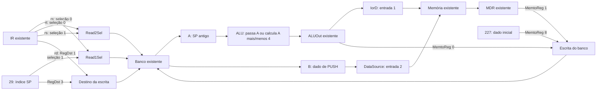

## M02 — Decodificação de PUSH, POP e BNE

PUSH funct 5 e BNE opcode 5 não conflitam: opcode é examinado primeiro.

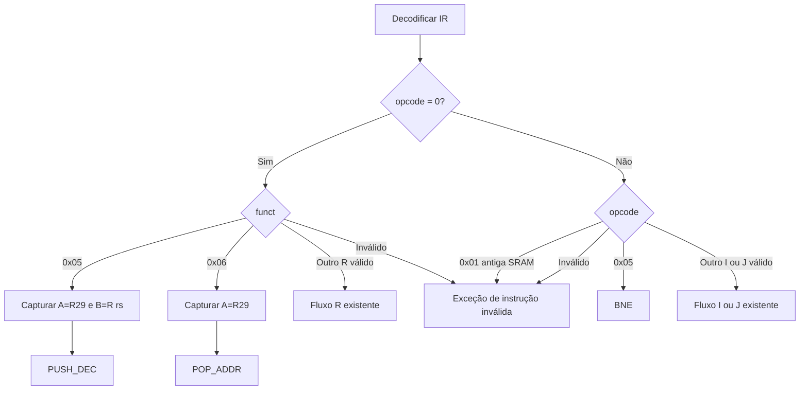

## M03 — PUSH: decrementa, atualiza SP e grava

Ordem do exemplo oficial: SP=227 → SP=223 → gravação em M32[223].

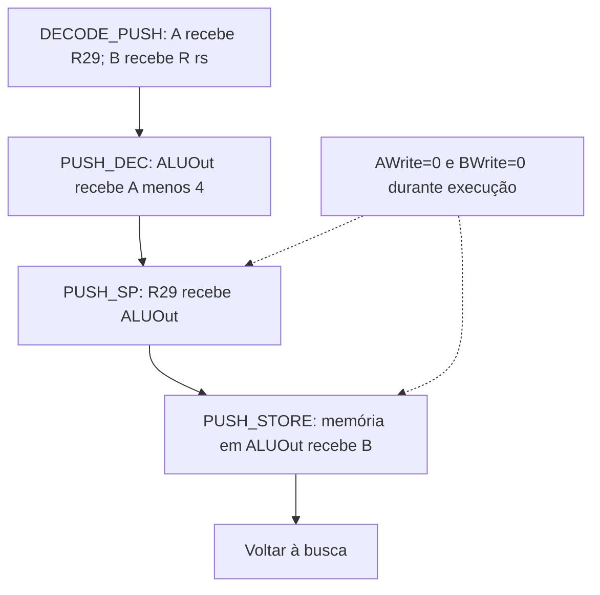

## M04 — POP: lê, escreve rd e incrementa SP

POP_ADDR reutiliza ALUOut → IorD → memória. As duas escritas do banco ocupam estados distintos.

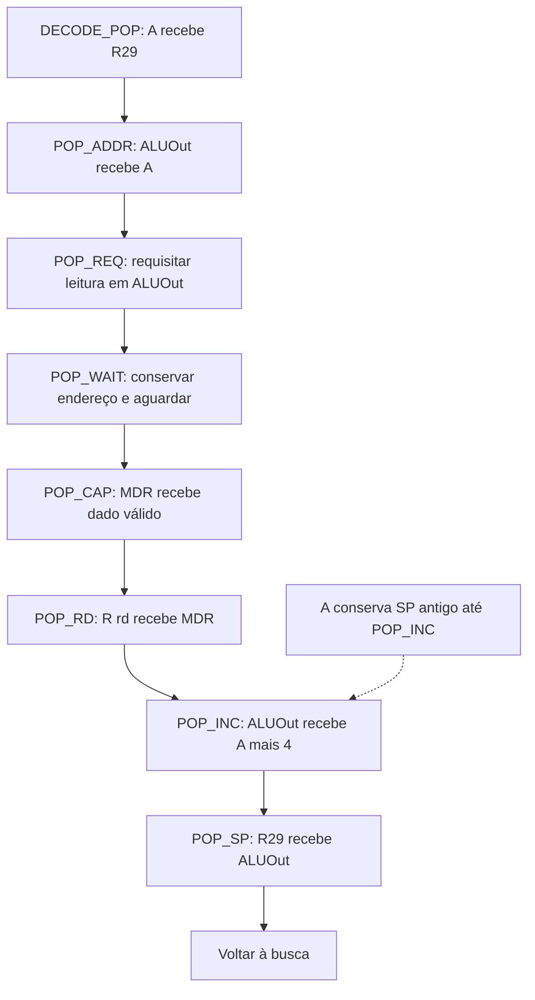

## M05 — Exemplo 227 → 223 → 227

A palavra passa de R8 à memória e retorna em R9. O SP volta ao ponto inicial.

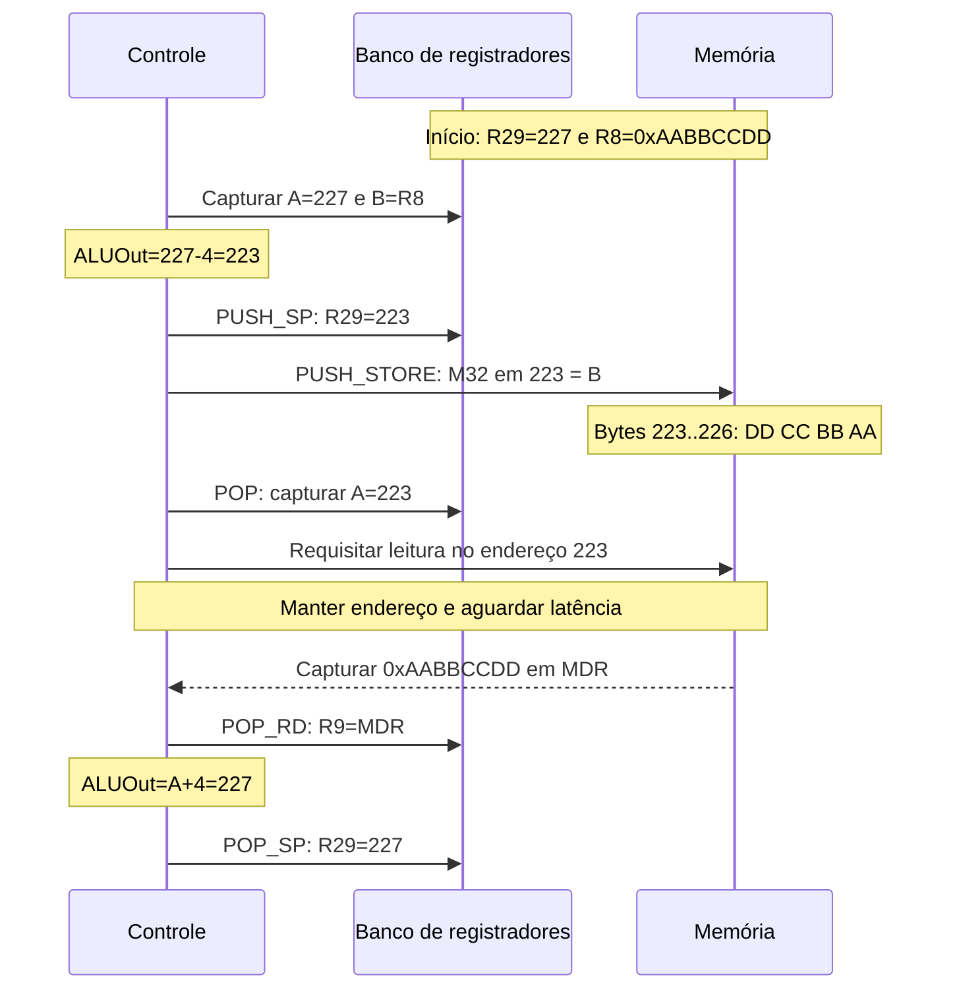

## M06 — Latência da leitura

Modelo conservador para o contrato do PDF. Conferir E0/E1/E2 com o HDL real antes de otimizar.

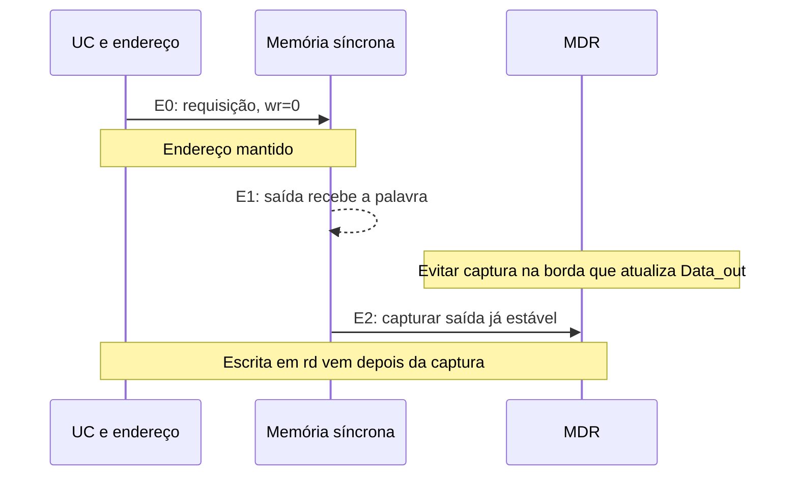

## M07 — Aritmética, AND e SLT

Estudo dos caminhos anteriores. A formação de 0/1 de SLT exige a conferência A01.

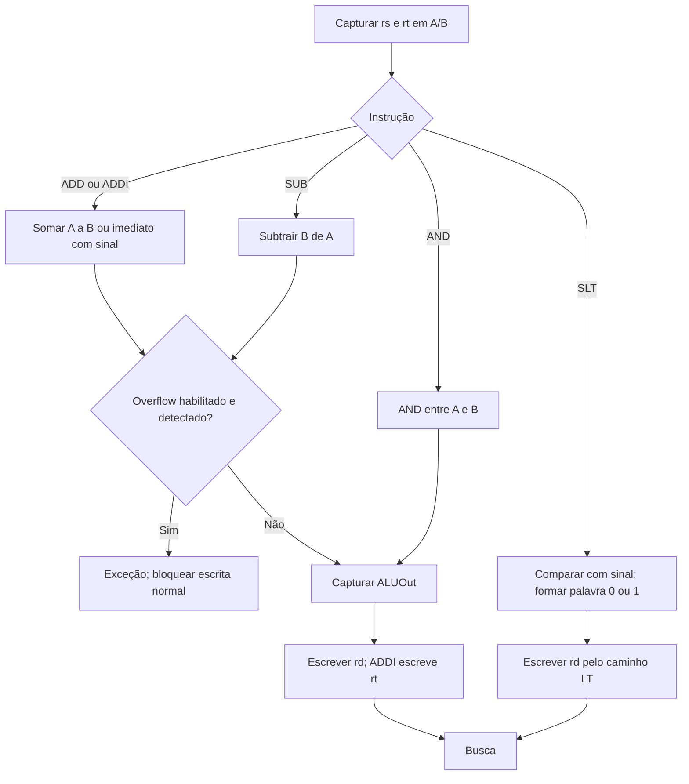

## M08 — BEQ e BNE

O alvo é comum; muda a condição que habilita o PC.

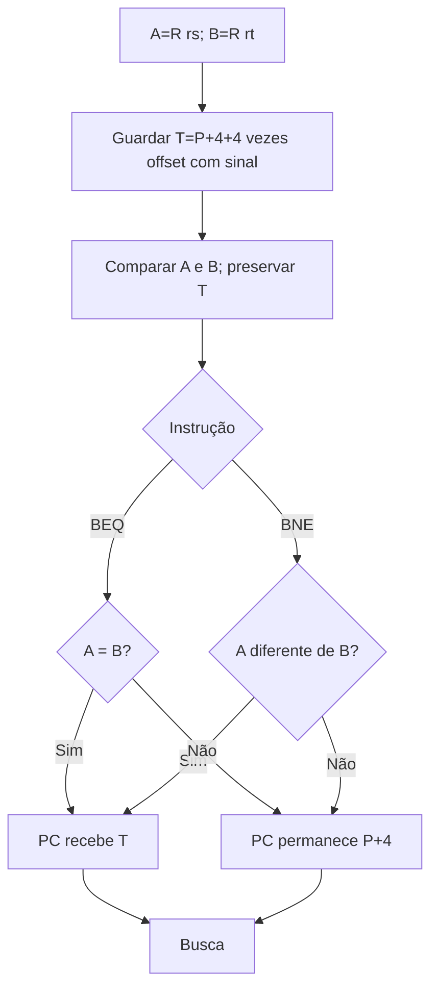

## M09 — SLL, SRA e LUI

LUI pelo SHIFT depende da conferência das fontes dos muxes, A07. Nenhum novo bloco de LUI foi acrescentado nesta revisão. MDR deixou de alimentar N para SRAM.

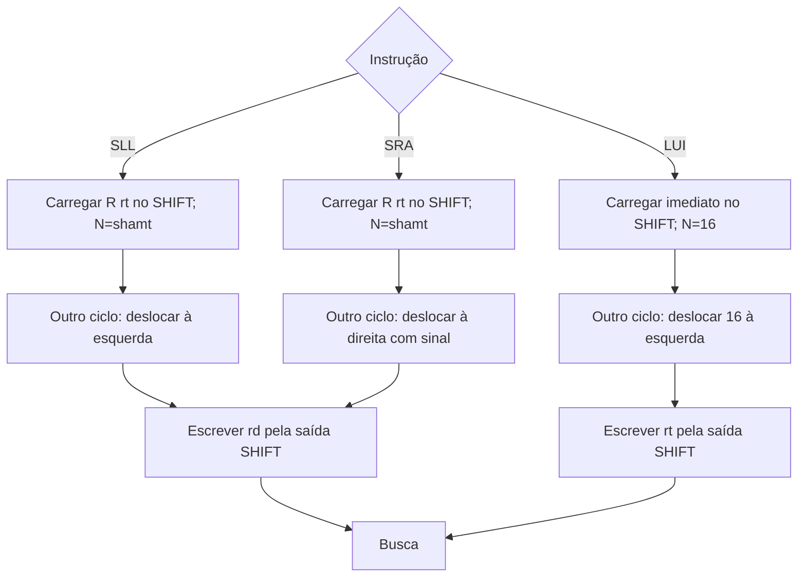

## M10 — MULT, DIV, MFHI e MFLO

MULT/DIV produzem HI/LO. MFHI/MFLO transferem esses valores ao banco.

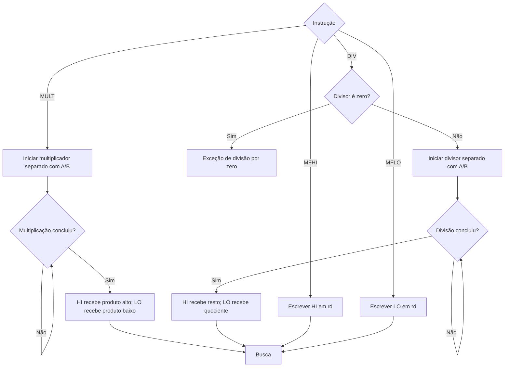

## M11 — LW, LB, SW e SB

Conferir MergeBytes e a interface real. Um eventual alinhamento para LB/SB não deve alterar o endereço exato de PUSH/POP.

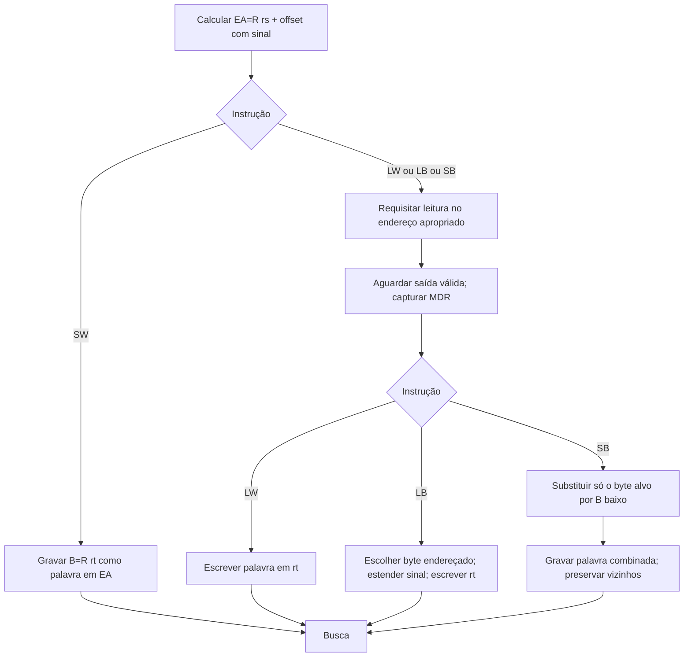

## M12 — Exceções exigidas

Requisito para conferir a UC existente: PC recebe o conteúdo do byte do vetor, não 253/254/255 diretamente.

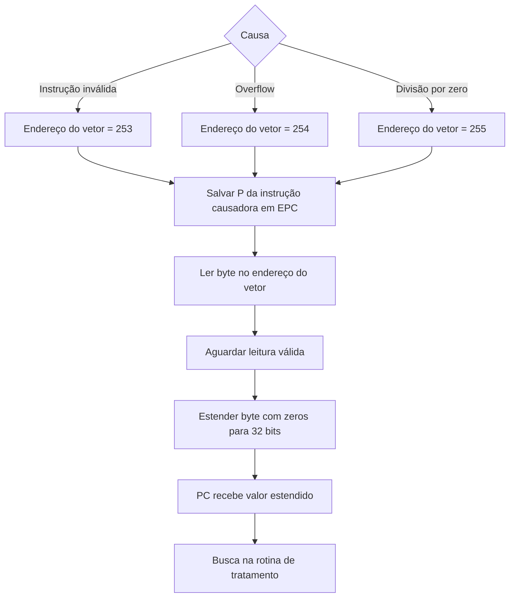

## M13 — J, JAL e JR

Os exemplos sem delay slot usam link=P+4; confirmar D01.

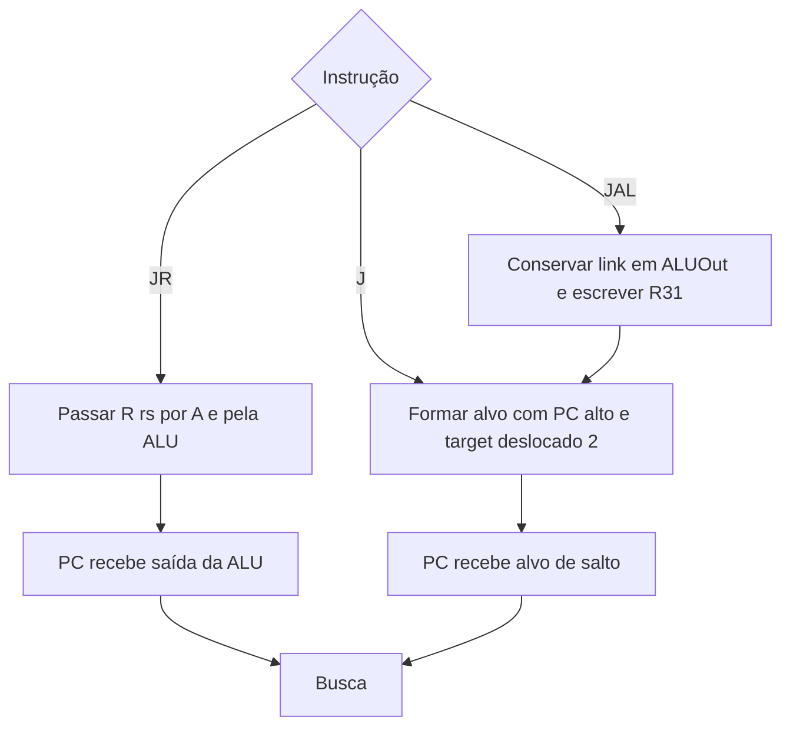
